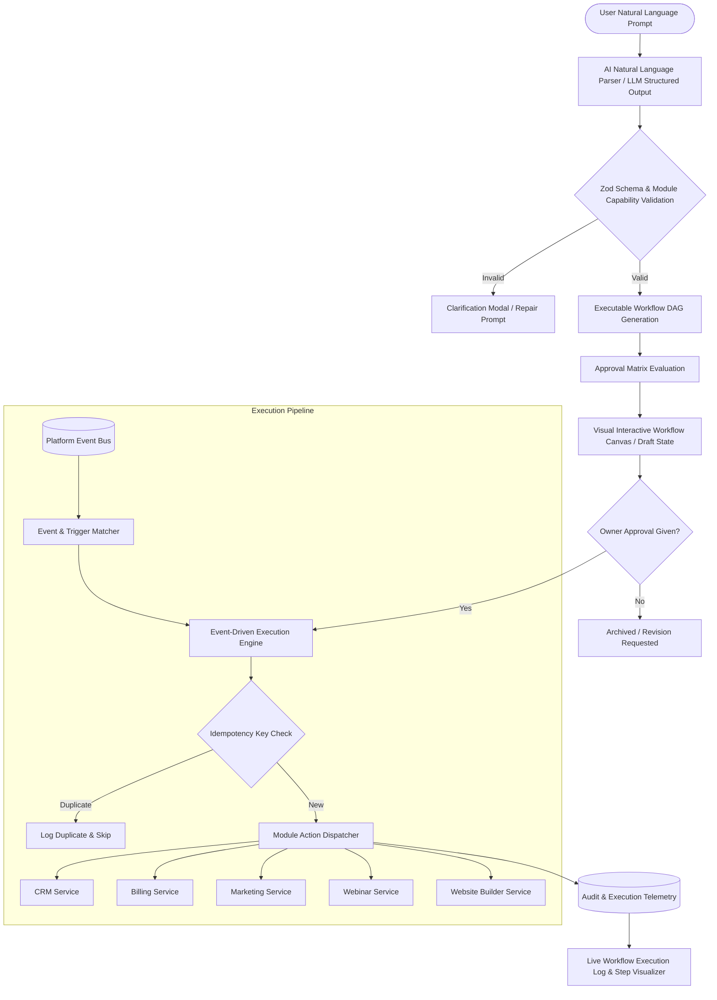

# Nexus: Natural Language to Executable Business Workflow Engine
## Comprehensive Architectural Specification & Autonomous Implementation Guide

> **Document Version:** 1.0.0 (Authoritative)  
> **Status:** Production Specification  
> **Target System:** Nexus AI-Powered Business Operating Platform (`project/`)  
> **Precedence Rules:** Follows [`AGENTS.md`](file:///c:/Users/ReniCd/Desktop/Hackathons/BNB_Internal_2026/AGENTS.md) and [`DESIGN.md`](file:///c:/Users/ReniCd/Desktop/Hackathons/BNB_Internal_2026/DESIGN.md).

---

## 1. Executive Summary & Core Value Proposition

### 1.1 The Breakthrough
Most AI business solutions operate as passive chatbots or shallow text-generation wrappers. **Nexus NL-to-Workflow** bridges natural language and autonomous business operations:
1. Translates unstructured English prompts into **Directed Acyclic Graph (DAG)** executable workflows.
2. Coordinates state transitions across platform modules: **Intelligent CRM, Visual Website Builder, SaaS Billing, Marketing Automation, and Webinar Management**.
3. Enforces **zero-untrusted-execution**: high-consequence operations (billing charges, mass email dispatch, public site deployment) require human approval checkpoints.
4. Guarantees deterministic, idempotent execution with step-level telemetry, retry queues, and audit trails.

### 1.2 The Archetype User Story
> *"When a customer attends our webinar but doesn't subscribe within two days, send a personalized offer. If they visit the pricing page, notify sales instead."*

Nexus parses this into:
- **Trigger Node:** `webinar.attendee.checked_in` (Webinar Module)
- **Delay / Condition Node:** `delay.duration(48h)` -> `crm.subscription.status == 'active'`
- **Branch A (True):** `marketing.email.send_offer(template_id: 'retention-48h', discount: '20%')`
- **Branch B (Condition Trigger: `analytics.page_view == '/pricing'`):** `crm.notification.notify_sales(lead_id, score: '+25')`

---

## 2. End-to-End Architectural Pipeline



---

## 3. Workflow DAG Specification & Types

All workflow definitions are represented as a strict Directed Acyclic Graph (DAG) validated through **Zod**.

### 3.1 Node Types & Capability Taxonomy

| Category | Node Type | Example Actions / Events | Reversibility |
|---|---|---|---|
| **Triggers** | `TRIGGER` | `crm.contact.created`, `webinar.attendee.registered`, `billing.subscription.canceled`, `website.form.submitted` | Read-only |
| **Conditions** | `CONDITION` | `equals`, `contains`, `greater_than`, `time_elapsed_without_event`, `crm.lead.score_above` | Reversible |
| **Delays** | `DELAY` | `delay.fixed(minutes, hours, days)`, `delay.until(timestamp)` | Reversible |
| **Actions** | `ACTION` | `marketing.email.send`, `crm.contact.update_tag`, `crm.lead.create_task`, `billing.invoice.create` | High-Impact |
| **Human Checkpoint**| `APPROVAL_GATE` | Pauses workflow run until explicit owner signature is received. | Human Gate |

### 3.2 Complete JSON Schema Definition (`WorkflowDefinition`)

```typescript
// project/lib/validations/workflow.ts
import { z } from "zod";

export const NodeCapabilitySchema = z.enum([
  "crm.contact.created",
  "crm.contact.updated",
  "crm.contact.tagged",
  "webinar.session.ended",
  "webinar.attendee.checked_in",
  "billing.subscription.created",
  "billing.subscription.canceled",
  "billing.invoice.failed",
  "website.page.viewed",
  "website.form.submitted",
  "marketing.email.send",
  "crm.lead.create_deal",
  "crm.notification.slack",
  "condition.branch",
  "delay.wait",
  "approval.manual_gate"
]);

export const WorkflowNodeSchema = z.object({
  id: z.string().uuid(),
  type: z.enum(["TRIGGER", "CONDITION", "DELAY", "ACTION", "APPROVAL_GATE"]),
  capability: NodeCapabilitySchema,
  label: z.string().min(1).max(100),
  description: z.string().optional(),
  config: z.record(z.string(), z.any()),
  requiresApproval: z.boolean().default(false),
  retryPolicy: z.object({
    maxRetries: z.number().int().min(0).max(5).default(3),
    backoffSeconds: z.number().int().min(5).max(3600).default(30),
  }).default({ maxRetries: 3, backoffSeconds: 30 }),
});

export const WorkflowEdgeSchema = z.object({
  id: z.string(),
  sourceNodeId: z.string().uuid(),
  targetNodeId: z.string().uuid(),
  conditionLabel: z.string().optional(), // 'True', 'False', or custom segment
  sourceHandle: z.enum(["default", "true", "false"]).default("default"),
});

export const WorkflowDAGSchema = z.object({
  title: z.string().min(3).max(120),
  description: z.string().max(500),
  naturalLanguagePrompt: z.string(),
  nodes: z.array(WorkflowNodeSchema).min(2),
  edges: z.array(WorkflowEdgeSchema).min(1),
  isHighImpact: z.boolean().default(false),
  estimatedAudienceCount: z.number().int().nonnegative().optional(),
});

export type WorkflowDAG = z.infer<typeof WorkflowDAGSchema>;
```

---

## 4. PostgreSQL Database Schema (Supabase Migration)

Add to versioned migration `project/supabase/migrations/20261011_workflow_engine.sql`:

```sql
-- 1. WORKFLOW DEFINITIONS TABLE
CREATE TABLE IF NOT EXISTS public.automation_workflows (
  id UUID PRIMARY KEY DEFAULT uuid_generate_v4(),
  business_id UUID NOT NULL REFERENCES public.businesses(id) ON DELETE CASCADE,
  title TEXT NOT NULL,
  description TEXT,
  natural_language_prompt TEXT NOT NULL,
  status TEXT DEFAULT 'DRAFT' NOT NULL, -- DRAFT, ACTIVE, PAUSED, ARCHIVED
  dag_definition JSONB NOT NULL,
  is_high_impact BOOLEAN DEFAULT false NOT NULL,
  execution_count INTEGER DEFAULT 0 NOT NULL,
  last_executed_at TIMESTAMPTZ,
  created_at TIMESTAMPTZ DEFAULT TIMEZONE('utc'::text, NOW()) NOT NULL,
  updated_at TIMESTAMPTZ DEFAULT TIMEZONE('utc'::text, NOW()) NOT NULL
);

CREATE INDEX IF NOT EXISTS idx_workflows_business ON public.automation_workflows(business_id);
CREATE INDEX IF NOT EXISTS idx_workflows_status ON public.automation_workflows(business_id, status);

ALTER TABLE public.automation_workflows ENABLE ROW LEVEL SECURITY;

DROP POLICY IF EXISTS "Owners can manage workflows" ON public.automation_workflows;
CREATE POLICY "Owners can manage workflows"
  ON public.automation_workflows FOR ALL
  TO authenticated
  USING (business_id IN (SELECT id FROM public.businesses WHERE owner_id = auth.uid()))
  WITH CHECK (business_id IN (SELECT id FROM public.businesses WHERE owner_id = auth.uid()));

-- 2. WORKFLOW RUNS (INSTANCES)
CREATE TABLE IF NOT EXISTS public.workflow_runs (
  id UUID PRIMARY KEY DEFAULT uuid_generate_v4(),
  workflow_id UUID NOT NULL REFERENCES public.automation_workflows(id) ON DELETE CASCADE,
  business_id UUID NOT NULL REFERENCES public.businesses(id) ON DELETE CASCADE,
  trigger_event_id TEXT,
  status TEXT DEFAULT 'RUNNING' NOT NULL, -- RUNNING, AWAITING_APPROVAL, COMPLETED, FAILED, CANCELLED
  current_node_id TEXT,
  context_data JSONB DEFAULT '{}'::jsonb NOT NULL,
  error_details JSONB,
  started_at TIMESTAMPTZ DEFAULT TIMEZONE('utc'::text, NOW()) NOT NULL,
  completed_at TIMESTAMPTZ
);

CREATE INDEX IF NOT EXISTS idx_workflow_runs_workflow ON public.workflow_runs(workflow_id);
CREATE INDEX IF NOT EXISTS idx_workflow_runs_status ON public.workflow_runs(business_id, status);

ALTER TABLE public.workflow_runs ENABLE ROW LEVEL SECURITY;

DROP POLICY IF EXISTS "Owners can view and control workflow runs" ON public.workflow_runs;
CREATE POLICY "Owners can view and control workflow runs"
  ON public.workflow_runs FOR ALL
  TO authenticated
  USING (business_id IN (SELECT id FROM public.businesses WHERE owner_id = auth.uid()))
  WITH CHECK (business_id IN (SELECT id FROM public.businesses WHERE owner_id = auth.uid()));

-- 3. STEP EXECUTION AUDIT TELEMETRY
CREATE TABLE IF NOT EXISTS public.workflow_step_logs (
  id UUID PRIMARY KEY DEFAULT uuid_generate_v4(),
  run_id UUID NOT NULL REFERENCES public.workflow_runs(id) ON DELETE CASCADE,
  workflow_id UUID NOT NULL REFERENCES public.automation_workflows(id) ON DELETE CASCADE,
  node_id TEXT NOT NULL,
  node_type TEXT NOT NULL,
  capability TEXT NOT NULL,
  status TEXT DEFAULT 'PENDING' NOT NULL, -- PENDING, EXECUTING, SUCCESS, FAILED, SKIPPED, PAUSED_FOR_APPROVAL
  idempotency_key TEXT UNIQUE NOT NULL,
  input_payload JSONB,
  output_payload JSONB,
  retry_count INTEGER DEFAULT 0 NOT NULL,
  execution_duration_ms INTEGER,
  executed_at TIMESTAMPTZ DEFAULT TIMEZONE('utc'::text, NOW()) NOT NULL
);

CREATE INDEX IF NOT EXISTS idx_step_logs_run ON public.workflow_step_logs(run_id);
CREATE INDEX IF NOT EXISTS idx_step_logs_idempotency ON public.workflow_step_logs(idempotency_key);

ALTER TABLE public.workflow_step_logs ENABLE ROW LEVEL SECURITY;

DROP POLICY IF EXISTS "Owners can read step telemetry" ON public.workflow_step_logs;
CREATE POLICY "Owners can read step telemetry"
  ON public.workflow_step_logs FOR SELECT
  TO authenticated
  USING (workflow_id IN (
    SELECT id FROM public.automation_workflows WHERE business_id IN (
      SELECT id FROM public.businesses WHERE owner_id = auth.uid()
    )
  ));
```

---

## 5. Directory Structure & File Inventory

To maintain modular depth and architectural cleanliness, structure the workflow engine under:

```text
project/
├── app/
│   ├── api/
│   │   └── workflows/
│   │       ├── generate/route.ts       # POST: Natural language to DAG (LLM + Zod)
│   │       ├── [id]/
│   │       │   ├── route.ts            # GET, PUT, DELETE workflow
│   │       │   ├── approve/route.ts    # POST: Human checkpoint approval
│   │       │   └── trigger/route.ts    # POST: Manual test trigger
│   │       ├── runs/[runId]/route.ts   # GET: Step-by-step run telemetry
│   │       └── route.ts                # GET: List workflows, POST: Save
│   └── dashboard/
│       └── workflows/
│           ├── page.tsx                # Server shell for workflow management
│           ├── workflow-list.tsx       # Active & draft workflows
│           ├── workflow-creator.tsx    # Natural language prompt composer
│           └── [id]/
│               └── page.tsx            # Visual DAG inspect & edit canvas
├── components/
│   └── workflows/
│       ├── node-card.tsx               # Visual token-styled DAG node
│       ├── dag-canvas.tsx              # Interactive workflow graph
│       ├── approval-banner.tsx         # High-impact confirmation gate
│       └── run-inspector.tsx           # Step-by-step real-time telemetry drawer
├── lib/
│   └── validations/
│       └── workflow.ts                 # Zod validation schemas
├── services/
│   ├── workflow-ai.service.ts          # LLM prompt compiler & validator
│   ├── workflow-engine.service.ts      # DAG traversal, step dispatcher & retries
│   └── workflow-event-bus.service.ts   # Event subscription & webhook triggers
└── supabase/
    └── migrations/
        └── 20261011_workflow_engine.sql
```

---

## 6. Detailed Implementation Checklist for Autonomous Execution

### Step 1: Migration & Data Contracts
- [ ] Create `supabase/migrations/20261011_workflow_engine.sql`.
- [ ] Author `lib/validations/workflow.ts` containing the complete Zod DAG schema.

### Step 2: AI Compiler Service (`WorkflowAIService`)
- [ ] Implement `services/workflow-ai.service.ts`.
- [ ] Accepts natural language input + current business schema context.
- [ ] Calls Gemini / OpenAI structured outputs adhering strictly to `WorkflowDAGSchema`.
- [ ] Applies topological sort check to ensure no cyclical dependencies exist in the graph.
- [ ] Tags nodes requiring human approval if `isHighImpact` (e.g. mass marketing, charge cards).

### Step 3: API Route Handlers
- [ ] Implement `app/api/workflows/generate/route.ts` (Thin handler, verifies auth & tenant, delegates to `WorkflowAIService`).
- [ ] Implement `app/api/workflows/[id]/approve/route.ts` (Validates single-tenant ownership, transitions state `AWAITING_APPROVAL` -> `RUNNING`).
- [ ] Implement `app/api/workflows/[id]/trigger/route.ts` (Allows owner to test-fire workflow with mock payload).

### Step 4: Deterministic Workflow Engine (`WorkflowEngineService`)
- [ ] Implement DAG node dispatcher with topological traversal.
- [ ] Compute deterministic idempotency key for each step:
  `sha256("${businessId}:${workflowId}:${runId}:${nodeId}:${eventTimestamp}")`
- [ ] Implement exponential backoff retry mechanism (3 retries: 5s, 15s, 45s).
- [ ] Pause execution and record state in `workflow_step_logs` if encountering an `APPROVAL_GATE`.

### Step 5: Frontend Visual Canvas & Inspector
- [ ] Build natural language prompt composer with real-time feedback.
- [ ] Build interactive SVG/HTML DAG viewer (Nodes, animated connection edges, status indicators).
- [ ] Add explicit human approval modal showing:
  1. Exact proposed actions.
  2. Estimated audience / recipient count.
  3. Irreversible consequences warning.
  4. Explicit `[Approve & Run]` vs `[Reject / Edit]` controls.

---

## 7. External Integrations & Requirements

### 7.1 Required API Keys & Environment Configurations
Ensure these environment variables are populated in `project/.env.local`:

| Variable | Purpose | Status |
|---|---|---|
| `NEXT_PUBLIC_SUPABASE_URL` | Supabase Project URL | Configured |
| `NEXT_PUBLIC_SUPABASE_PUBLISHABLE_KEY` | Client Supabase Key | Configured |
| `SUPABASE_SECRET_KEY` | Server Service-Role Key (RLS Bypass) | Configured |
| `GEMINI_API_KEY` or `OPENAI_API_KEY` | LLM compiler for Natural Language to DAG | **Required for prompt parser** |

---

## 8. Verification & Quality Gates

Before declaring feature completion:
1. **Lint Verification:** `npm --prefix project run lint` exits with code 0.
2. **Type & Build Verification:** `npm --prefix project run build` compiles with zero TypeScript or CSS errors.
3. **Idempotency Proof Test:** Trigger the same event ID twice; verify step 2 logs `SKIPPED` with duplicate idempotency key.
4. **Tenant Isolation Proof:** Verify an authenticated user cannot query or trigger workflow DAGs belonging to another `business_id`.
